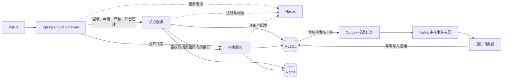

# 社区便民服务申请与进度管理系统升级方案

> 设计稿 · 2026-11-10 · 面向简历项目、现场演示和面试讲解

## 1. 目标与现状

在现有 Vue 3、Java 17、Spring Boot 3.2.5、MyBatis-Plus、Shiro 和 MySQL 基础上，引入 Spring Cloud Gateway、Nacos 和 Kafka，扩展已有 Redis 的用途。验收以三条实际链路为主：网关按服务名路由，热点查询合并回源，审核消息可恢复且重复消费只生成一条通知。

| 当前实现 | 改造切入点 |
| --- | --- |
| 后端是一个 Spring Boot 应用，前端统一请求 `/api`。 | 从办事指南开始拆分。指南服务只访问 `guide` 表，适合用来验证独立部署和服务发现。 |
| 申请、审核、附件和权限在同一应用内。审核已用状态和版本号做条件更新。 | 申请与审核记录继续用本地事务。进度查询实时读取 MySQL，并保留现有访问校验。 |
| Redis 已存储会话、限流计数、临时附件标识，也用于预警任务加锁。 | 补业务查询缓存，修限流原子性与在线会话全量扫描。 |
| 初审和复审在请求线程里调用站内通知逻辑，异常仅记录日志。 | 审核事务写入 Outbox 待发布事件，Kafka 消费端异步生成通知。 |

主要代码入口见 [后端依赖](../backend/pom.xml)、[指南服务](../backend/src/main/java/com/community/service/impl/GuideServiceImpl.java)、[审核及进度服务](../backend/src/main/java/com/community/service/impl/ApplicationFormServiceImpl.java) 和 [进度查询控制器](../backend/src/main/java/com/community/controller/apply/ApplyController.java)。

## 2. 目标架构

| 部署单元 | 职责与边界 |
| --- | --- |
| `community-gateway` | 唯一对外 API 入口。显式配置路由、客户端 IP 信任规则、请求追踪和超时。Vue 开发代理改指向网关，接口路径、响应结构和会话 Cookie 兼容现有前端。 |
| `community-core` | 从现有 `backend` 演进。负责登录、Shiro 权限、居民、事项、申请、审核、附件、预警、报表和通知。Outbox 投递任务和通知消费者先作为独立代码模块随核心服务部署。 |
| `community-guide` | 独立启动和注册，负责公开指南查询、指南维护及对应缓存。第一期复用 MySQL 实例，单独配置数据库账号，由指南服务独占 `guide` 表写入。 |

### 路由、鉴权与配置

- `GET /api/guide/public` 优先匹配并转发给 `lb://community-guide`。其他已公开的 `/api` 业务路径转发给 `lb://community-core`。核心服务保留 `/api` 上下文路径，网关转发时保留此前缀。指南服务公开路由采用相同前缀。通过 Nacos 发现两个指南实例，Spring Cloud LoadBalancer 负责选实例。 [Spring Cloud Gateway 负载均衡文档](https://docs.spring.io/spring-cloud-gateway/reference/spring-cloud-gateway-server-webmvc/filters/loadbalancer.html)
- 后台指南接口先进入核心服务。保留现有登录要求和 `guide:manage` 写权限，再按服务名调用指南服务的内部接口。内部接口仅允许私网内经过服务身份验证的核心服务访问。网关不路由内部接口及管理端点。网关透传 Cookie 和请求追踪 ID，后台写请求不做自动重试。 [现有指南权限](../backend/src/main/java/com/community/controller/guide/GuideController.java)
- Nacos 按环境划分 namespace，每个服务使用独立配置项。先把缓存 TTL 和限流阈值等非敏感参数放进配置中心，用 `spring.config.import` 引入。对需要动态刷新的参数做范围校验，并通过联调确认客户端实际生效。数据库密码、Redis 密码、JWT 密钥和服务凭据从部署环境注入。 [Nacos 配置与发现快速开始](https://sca.aliyun.com/docs/2023/user-guide/nacos/quick-start/)
- 简历演示先保留 Java 17 和 Boot `3.2.x`，用 Spring Cloud `2023.0.x` 和 Spring Cloud Alibaba `2023.0.x` 做兼容验证。官方矩阵的参考组合是 Boot `3.2.4`、Cloud `2023.0.1`、Alibaba `2023.0.1.0`，表中对应 Nacos `2.3.2`。现有 Boot `3.2.5` 先做启动和接口回归，再锁定 BOM 与镜像版本。Cloud `2023.0.x` 已结束开源支持。若后续长期部署，单独验证 Boot `4.0.x`、Cloud `2025.1.x`、Alibaba `2025.1.x` 以及 Shiro、MyBatis-Plus、Spring Session、SpringDoc 的兼容性。 [Spring Cloud 兼容表](https://spring.io/projects/spring-cloud/) · [Alibaba 2023 版本矩阵](https://sca.aliyun.com/docs/2023/overview/version-explain/) · [Alibaba 2025 版本矩阵](https://sca.aliyun.com/docs/2025.x/overview/version-explain/)

## 3. Redis 缓存与现有问题修复

### 3.1 选择缓存对象

| 接口 | 策略 |
| --- | --- |
| `GET /api/guide/public` | 先上线。固定键 `cache:guide:public:v1`，只缓存已发布指南，空列表也缓存。 |
| `GET /api/item/enabled` | 第二个固定键 `cache:item:enabled:v1`。后台改动后失效，公开提交时仍从数据库校验事项状态。 |
| `GET /api/apply/progress` | 继续实时查询。保留手机号后四位校验、统一失败响应和申请编号索引，加强入口限流。 |

读采用 Cache-Aside。命中直接返回，未命中由一个实例回源并回填。TTL 初始建议为 5 分钟加 0–60 秒随机抖动。指南和事项更新在 MySQL 提交后失效对应缓存。失效失败记录日志及计数并有界重试，TTL 兜底。在 MySQL 与 Redis 分别提交的方案下，缓存存在短暂陈旧窗口。 [Redis Cache-Aside](https://redis.io/docs/latest/develop/use-cases/cache-aside/)

### 3.2 雪崩、击穿和穿透

代码检查范围内，现有 Redis 用途没有形成业务缓存未命中后回源 MySQL 的链路。以下是新增业务缓存后的风险与应对。

| 风险 | 本项目触发条件 | 处理与验证 |
| --- | --- | --- |
| 击穿 | 公开指南的单个热点键到期，多个实例同时读。 | 用带随机持有者标识的 Redis 短租约锁合并回源。加锁后再查缓存，未拿到锁的请求短暂等待并重读，到达等待上限后按回源预算处理。用 Lua 校验持有者后解锁。压测冷键并记录 MySQL 查询次数。 |
| 雪崩 | 将来大量详情键同一时段到期，或 Redis 不可用后大量查询一起回源。首期只有两个列表键，重点测 Redis 故障。 | TTL 加抖动，缓存访问设置短超时和熔断。公开列表使用有并发上限的回源，超出预算返回可重试的 `503`。在两个实例上计算总回源预算，并观察连接池。 |
| 穿透 | 将来按事项 ID 缓存详情，不存在的 ID 反复回源。现有公开进度查询也会因大量无效申请号直接查库。 | 固定键缓存 `[]`。详情将来上线时，确实不存在的合法 ID 可短暂缓存空结果，随机 ID 攻击靠格式校验及入口限流。进度查询加强申请号长度和格式校验，按实际生成规则兼容历史编号。 |

对两个固定列表键，回填还需覆盖一次读写竞态。缓存重建时记录当前缓存代数。写侧提交后原子递增代数并删除数据键。重建者仅在租约仍归自己且代数未变时回填，避免慢读在失效后把旧结果写回。代数键保留，业务缓存实例恢复后优先执行失效重试；Redis 与 MySQL 的短暂不一致仍由重试和 TTL 约束。

### 3.3 修复已有 Redis 路径

- **可信客户端 IP**。公开进度、申请和上传等入口目前直接读取 `X-Forwarded-For`。网关丢弃外部自带的转发头，仅从直接连接或受信代理链提取 IP，再写入可信头。后端只接受来自网关的该头，服务端口不对外开放。增加伪造转发头的回归用例。 [进度查询控制器](../backend/src/main/java/com/community/controller/apply/ApplyController.java)
- **原子限流**。把 `INCR` 和首次设置 TTL 合为 Lua 操作，遇到历史 `TTL = -1` 的计数键也补设过期。现有限额作为起点，按合法用户行为和压测数据调整。Redis 无法提供限流状态时，对公开进度、提交和上传返回可重试的服务不可用响应，避免直接放开。 [现有限流服务](../backend/src/main/java/com/community/service/impl/PublicRateLimitServiceImpl.java) · [Redis 限流示例](https://redis.io/docs/latest/commands/incr/)
- **会话扫描与任务加锁**。在线会话列表将 `KEYS` 改为有扫描预算的游标遍历，处理扫描期间的会话过期和重复键。预警任务的锁使用独立持有者标识和原子条件删除，避免旧任务删掉新任务的锁。多实例运行前验证任务耗时与租约，预警写入继续依靠数据库唯一约束兜底。 [会话接口](../backend/src/main/java/com/community/controller/system/SessionController.java) · [预警任务](../backend/src/main/java/com/community/task/TimeoutWarningScheduler.java) · [Redis SCAN](https://redis.io/docs/latest/commands/scan/)
- **按用途区分故障处理**。列表缓存故障走受限回源。会话和临时附件属于有状态依赖，按实际错误返回服务不可用或要求重新上传。演示环境可以共用 Redis 实例，缓存压力测试与有状态功能联调分开执行。若后续部署需要隔离故障域，再拆 Redis 实例。

## 4. Kafka 审核通知设计

### 4.1 事件与数据归属

| 项目 | 设计 |
| --- | --- |
| Topic / 消费组 | `community.application.audit.v1` / `community-notification-v1`。消息键使用 `applicationId`。 |
| 事件字段 | `eventId`、`schemaVersion`、`applicationId`、`auditRecordId`、`auditType`、`auditResult`、`applicationVersion`、`occurredAt`。 |
| 数据归属 | 审核状态和记录以 MySQL 为准。消息仅传内部标识和状态，消费者从核心数据读取生成通知所需的内容。手机号、身份证、附件和自由填写的审核意见留在原业务库。 |

Kafka 保证同一分区按写入顺序读取。Outbox 重试仍可能让较早事件晚于较新事件发布。通知按每次审核记录独立生成，展示使用 `occurredAt` 排序。将来如果增加按事件维护当前状态的消费者，再按 `applicationVersion` 拒绝旧版本覆盖。 [Kafka 分区与顺序](https://kafka.apache.org/documentation/)

### 4.2 从事务提交到通知落库

1. **事务内记账**。保留初审和复审的状态条件更新，写审核记录，并在同一事务插入 `application_event_outbox`。使用稳定的 `event_id`，按事件类型和审核记录 ID 做唯一约束。审核失败则申请、记录和事件一起回滚。
2. **后台投递**。Outbox 记录至少包含事件内容、状态、尝试次数、下次重试时间、租约持有者与到期时间、创建时间和发送时间。任务小批领取到期记录，在短数据库事务内提交租约，再发送 Kafka。收到 Broker 确认后用持有者条件更新为 `SENT`。失败则退避重试，进程异常退出后过期租约可被重新领取。长期积压和不可恢复错误需要可见并支持人工重投。
3. **消费幂等**。为 `notification` 新增允许为空的 `source_event_id` 与唯一索引，兼容历史和手动通知。消费者按事件读取对应审核记录，在数据库事务内写通知。重复事件命中该唯一约束后按已处理返回，其他数据库异常继续重试。消费位点在事务提交后确认。Broker 已确认但 Outbox 未标记、或通知已落库但位点未提交，都允许重投。
4. **失败收敛**。短暂故障做有限重试，超过上限的消息写入死信主题，死信写入确认后再提交原位点。重放保留 `eventId`，记录事件 ID、错误类型和尝试次数。消息消费失败期间，居民仍可通过原有接口查询已提交的审核结果。 [Kafka 投递语义](https://kafka.apache.org/40/design/design/)

新增数据库迁移脚本用于已有环境，并同步新建环境的初始化结构。部署时先迁移数据表，再发布兼容代码。在开启 Kafka 路径时关闭原审核通知的同步写入，避免同一次审核生成两条通知。手动通知和超时预警通知继续沿用现有入口。

## 5. 实施与回退

| 阶段 | 交付内容 | 完成条件 |
| --- | --- | --- |
| 1. 建立基线 | 记录登录、指南发布与下架、公开提交、附件上传、初审复审和进度查询行为。保存固定并发下公开指南的响应时间与 SQL 次数。 | 有可重复执行的请求数据和基线记录。 |
| 2. Redis 优化 | 先上公开指南缓存，再上启用事项列表。修原子限流、会话扫描和预警锁。 | 验证空列表缓存、更新失效、热点回源和 Redis 故障行为。 |
| 3. 网关与服务拆分 | 先让 Gateway 和 Nacos 接管现有后端入口，再迁移指南业务。部署时确保公开读和后台写同批切换，由一个服务写 `guide`。 | 前端接口兼容，两个指南实例注册成功，停掉一个实例后路由可恢复。 |
| 4. Kafka 异步通知 | 迁移表结构，启用 Outbox、发布任务和通知消费者。准备故障注入、重试和重放演示。 | Broker 故障期间审核可提交，恢复后补发；重复投递只落一条通知。 |

本地演示使用 Docker Compose 启动 MySQL、Redis、Nacos 和 Kafka，应用按依赖就绪状态启动。单 Broker 用来演示停机与恢复，双指南实例用来演示服务发现和负载均衡。对外只映射网关与前端所需端口，控制台按需仅绑定本机。初期核心服务使用单实例和现有附件目录，双实例演示限定在指南服务。

切换前备份数据库并留存上一版配置。缓存故障可关闭缓存入口，继续按预算查询数据库。指南迁移失败时，先停止新服务写入，再切回旧指南实现并清理相关缓存。Kafka 路径需要回退时，先停止产生新的 Outbox 事件，恢复同步通知只处理切换后的新审核，已有待发事件仍按原 `eventId` 补发。回退期间保留新增表和历史待发记录。

## 6. 验收与简历展示

| 场景 | 操作 | 预期与留证 |
| --- | --- | --- |
| 服务发现与权限 | 访问两个指南实例，停掉其中一个。分别用匿名、普通账号和有 `guide:manage` 权限的账号调用对应接口。 | 保存 Nacos 实例列表、网关请求 ID 和实例日志。服务发现收敛后由剩余实例响应，指南管理权限与现有规则一致。 |
| 缓存命中与击穿 | 对同一公开指南键分别测试无缓存、热缓存和冷键并发。让后台在回填中途下架指南。 | 记录命中率、P95 和 MySQL 查询数。正常冷键重建窗口内只有一个回源请求；下架后的旧回填被拒绝。 |
| Redis 故障与无效请求 | 停 Redis 并发请求公开列表。恢复后发送大量合法格式的无效申请号，同时变换自带的转发头。 | 列表回源未超过预算，超限返回可重试错误。伪造头未绕过限流，进度入口仍校验手机号后四位。 |
| 审核事务与补发 | 停 Kafka 后审核一笔，恢复 Kafka；另模拟审核事务回滚。 | 停机时申请状态与审核记录已提交，Outbox 可查询；恢复后产生对应通知。事务回滚时没有待发事件。 |
| 幂等与重放 | 重投相同事件，或模拟通知提交后、位点提交前消费者退出。 | 按 `source_event_id` 查询只有一条通知。留存 Outbox 状态、消费日志和积压变化。 |

简历可按「场景 → 改动 → 实测结果」写。以下表述在对应验收通过后使用，指标填写实际测量值。

- 使用 Spring Cloud Gateway、Nacos 和 LoadBalancer 将办事指南拆为独立服务，验证双实例下线切换及原有接口兼容。
- 为公开办事指南引入 Redis Cache-Aside 和跨实例回源合并，在 `[并发条件]` 下将冷键窗口内的 MySQL 查询次数从 `[基线]` 降至 `[实测]`。
- 使用 Kafka、MySQL Outbox 和消费端唯一约束解耦审核与通知，验证 Broker 停机期间审核可提交、恢复后补发、重复投递只生成一条通知。
